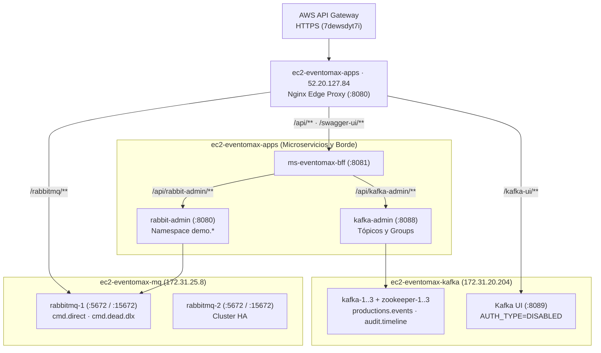

<a href="https://7dewsdyt7i.execute-api.us-east-1.amazonaws.com/kafka-ui/">
  
</a>

> **Caso de Estudio 8:** Plataforma B2B de Producción y Montaje de Eventos &nbsp;|&nbsp; **Asignatura:** Desarrollo Cloud Native (`DSY1107`) &nbsp;|&nbsp; **Equipo:** Ignacio Valeria, Benjamín Flores, Benjamín Espinoza

## Propósito del Repositorio

`infra-eventomax` centraliza la definición reproducible de la capa de borde y mensajería distribuida de **EventoMax**:

- **Edge Reverse Proxy (`proxy/`):** Contenedor Nginx `1.27-alpine` que unifica bajo el puerto `8080` las rutas hacia `ms-eventomax-bff` (`/api/**`, `/swagger-ui/**`, `/v3/api-docs/**`), **Apache Kafka UI** (`/kafka-ui/**`) y **RabbitMQ Management** (`/rabbitmq/**`), preservando rutas codificadas (`%2F` de vhosts AMQP) y permitiendo payloads de hasta `15 MiB` para carga de imágenes en catálogo.
- **Clúster Apache Kafka (`kafka/`):** 3 brokers Confluent (`kafka-1..3`, Zookeeper 3 nodos), inicialización idempotente de tópicos (`init-topics.sh`) con `replication-factor=3` y **Kafka UI** (`provectuslabs/kafka-ui:v0.7.2`) expuesta en modo consulta directo (`AUTH_TYPE=DISABLED`).
- **Clúster RabbitMQ HA (`mq/`):** 2 nodos (`rabbitmq-1`, `rabbitmq-2`, imagen `4.3.6-management`) con topología predeclarada (`definitions.json`) para comandos operativos (`cmd.direct`, `cmd.topic`) y manejo de fallos (`cmd.dead.dlx`).
- **Servicios Administrativos (`rabbit-admin/` y `kafka-admin/`):** APIs Spring Boot `4.1.1` (Java `25`) protegidas por OAuth2/JWT de Microsoft Entra ID (`ROLE_Admin` + `SCOPE_access_as_user`) para inspección y gestión controlada de brokers sin exponer credenciales de administración al navegador.

## Accesos en Vivo (Demo AWS)

| Interfaz | Enlace HTTPS | Usuario | Contraseña / Método |
| :--- | :--- | :--- | :--- |
| **Portal Web EventoMax** | [Abrir Portal Web](https://eventomax-production-portal-app.s3.us-east-1.amazonaws.com/index.html) | Cuenta Microsoft Entra ID | Login federado OAuth 2.0 (PKCE) |
| **Swagger UI (API BFF)** | [Abrir Swagger UI](https://7dewsdyt7i.execute-api.us-east-1.amazonaws.com/swagger-ui/index.html) · [JSON](https://7dewsdyt7i.execute-api.us-east-1.amazonaws.com/v3/api-docs) | Lectura pública | Pruebas sobre `/api/**` con `Bearer <JWT>` |
| **Apache Kafka UI** | [Abrir Kafka UI](https://7dewsdyt7i.execute-api.us-east-1.amazonaws.com/kafka-ui/) | Sin login | Acceso directo a `eventomax-prod-cluster` |
| **RabbitMQ Management** | [Abrir RabbitMQ UI](https://7dewsdyt7i.execute-api.us-east-1.amazonaws.com/rabbitmq/) | `eventomax` | `eventomax` |

*Nota operativa: los contenedores se ejecutan en **AWS Academy Learner Lab** distribuidos en 3 instancias (`ec2-eventomax-apps`, `ec2-eventomax-kafka`, `ec2-eventomax-mq`).*

## Topología de Brokers y Servicios Admin

### Apache Kafka (`kafka/init-topics.sh`)

| Tópico | Particiones | Política de Limpieza | Retención | Uso en EventoMax |
| :--- | :---: | :--- | :---: | :--- |
| `productions.events` | `3` | `delete` | `7 días` | Eventos de dominio emitidos vía Outbox desde `ms-eventomax-productions` |
| `audit.timeline` | `3` | `compact,delete` | `30 días` | Flujo compactado por clave de agregado (`productionId`) en `ms-eventomax-audit` |
| `productions.events.report.DLT` | `3` | `delete` | `14 días` | Dead Letter Topic del consumidor analítico `report-group` |
| `productions.events-audit-retry` | `3` | `delete` | `7 días` | Tópico de reintentos diferidos de `ms-eventomax-audit` |
| `productions.events-audit-dlt` | `3` | `delete` | `14 días` | Dead Letter Topic del consumidor de auditoría |

`kafka-admin/` (`port 8088`) expone `/api/kafka-admin/topics/**` y `/api/kafka-admin/consumer-groups/**` a través del BFF.

### RabbitMQ (`mq/definitions.json` + `rabbit-admin/`)

- **Exchanges:** `cmd.direct` (`direct`), `cmd.topic` (`topic`) y `cmd.dead.dlx` (`direct`).
- **Colas operativas y DLQ:** `q.cmd.email` → `q.cmd.email.dlq`, `q.cmd.crew` → `q.cmd.crew.dlq` y `q.cmd.quote` → `q.cmd.quote.dlq`.
- **Guardrails de `rabbit-admin/` (`expose 8080`):** restringe operaciones REST exclusivamente al namespace `demo.*` (`ResourcePolicy`), bloqueando con `403 Forbidden` mutaciones o lecturas sobre colas operativas `q.cmd.*` y exigiendo borrado condicional seguro (`ifUnused=true`, `ifEmpty=true`).

## Stack Tecnológico

<table>
  <tr>
    <td align="center" width="25%">
      <br />
      <strong>Docker &amp; Nginx 1.27</strong>
    </td>
    <td align="center" width="25%">
      <picture>
        <source media="(prefers-color-scheme: dark)" srcset="docs/assets/tech/apache-kafka-dark.svg" />
        
      </picture><br />
      <strong>Apache Kafka 7.8</strong>
    </td>
    <td align="center" width="25%">
      <br />
      <strong>RabbitMQ 4.3 HA</strong>
    </td>
    <td align="center" width="25%">
      <br />
      <strong>Java 25 · Boot 4.1</strong>
    </td>
  </tr>
  <tr>
    <td align="center" width="25%">
      <br />
      <strong>Entra ID (JWT)</strong>
    </td>
    <td align="center" width="25%">
      <br />
      <strong>AWS API Gateway</strong>
    </td>
    <td align="center" width="25%">
      <br />
      <strong>Amazon EC2 (×3)</strong>
    </td>
    <td align="center" width="25%">
      <br />
      <strong>Kafka UI v0.7.2</strong>
    </td>
  </tr>
</table>

## Distribución en AWS



## Validación y Despliegue por Módulo

```bash
# Red privada compartida en Docker
docker network create eventomax-net

# 1. Validar configuración de Compose (Kafka, MQ, Edge Proxy y Admins)
docker compose --env-file .env.prod.example -f kafka/compose.prod.yml config -q
docker compose --env-file .env.prod.example -f mq/compose.prod.yml config -q
docker compose --env-file .env.prod.example -f proxy/compose.prod.yml config -q

# 2. Pruebas automatizadas y build de rabbit-admin y kafka-admin
cd rabbit-admin && mvn -B -ntp verify && cd ..
cd kafka-admin && ./mvnw -B -ntp verify && cd ..
```
